# 🏡 Projet Garderie DevOps — Ma Garderie

<!-- Badges -->


🎨 **Design** : Conception d'une interface web moderne, responsive et adaptée à une garderie d'enfants.
📄 **Rapport du projet** : [Consulter le rapport complet (Examen tp.pdf)](./Examen%20tp.pdf)

Bienvenue sur le dépôt officiel du projet **Ma Garderie**, réalisé dans le cadre de l'épreuve pratique du Master DevOps & Cloud.

Ce projet consiste à développer et à déployer une application web pour une garderie d'enfants en utilisant les pratiques DevOps : conteneurisation, intégration continue, automatisation de l'infrastructure et déploiement.
## 📋 1. Présentation du projet

L'application **Ma Garderie** est une landing page responsive connectée à une API REST.

| Élément | Technologie |
|---|---|
| Frontend | Next.js, React, Tailwind CSS |
| Backend | Node.js, Express |
| Tests automatisés | Jest |
| CI/CD | Jenkins |
| Conteneurisation | Docker, Docker Compose |
| Infrastructure | Vagrant, Ansible |
| Gestion du code source | Git, GitHub |
| Registre d'images | Docker Hub |

## 🏗️ 2. Architecture et chaîne CI/CD

Le projet utilise une chaîne CI/CD permettant d'automatiser la construction, les tests et la publication des images Docker.

Les principales étapes sont :

1. Récupération du code source depuis GitHub.
2. Installation des dépendances.
3. Exécution des tests automatisés.
4. Construction des images Docker du frontend et du backend.
5. Publication des images sur Docker Hub.
6. Déploiement de l'application avec Docker Compose.
7. Automatisation de la configuration de l'infrastructure avec Ansible.

Le fichier `Jenkinsfile` définit le pipeline, le `Vagrantfile` configure la machine virtuelle et le fichier `docker-compose.yml` permet de démarrer les services.

## 📸 3. Réalisation du projet et preuves d'exécution

### 3.1. Installation de Docker et Jenkins

Cette étape consiste à préparer l'environnement DevOps en installant Docker et Jenkins. Docker permet de conteneuriser l'application, tandis que Jenkins automatise les différentes étapes du pipeline CI/CD.

**Installation initiale :**

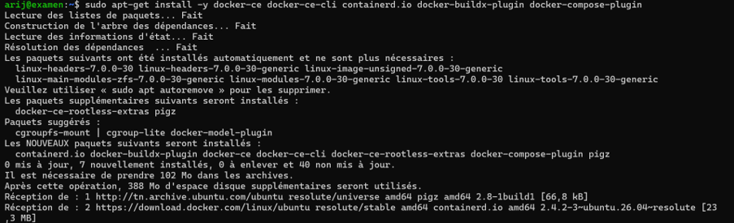

**Étape 2 :**

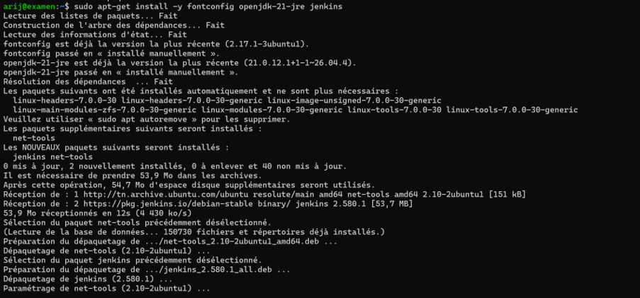

**Étape 3 :**

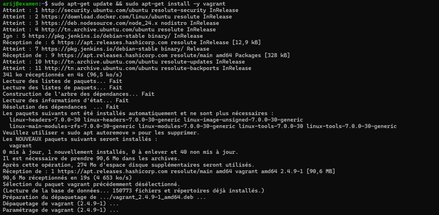

**Étape 4 :**

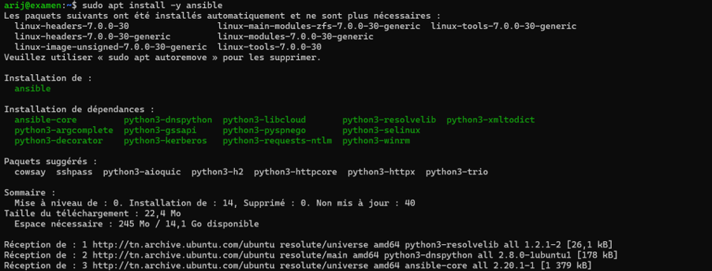

### 3.2. Création de l'application

Le frontend est développé avec Next.js et React. Le backend, basé sur Node.js et Express, expose une API REST permettant les échanges de données avec l'application.

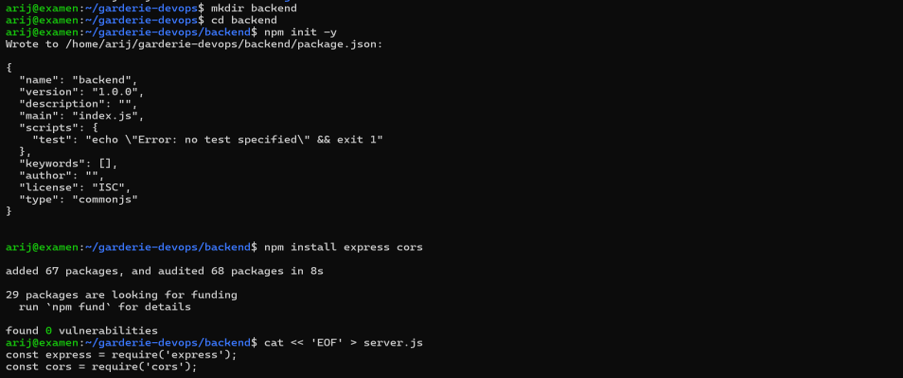

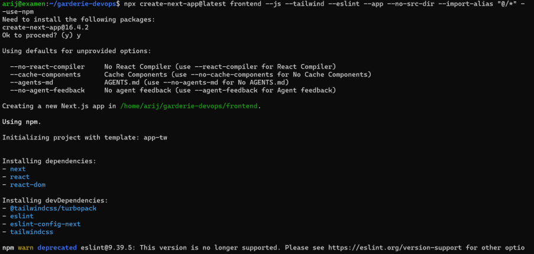

### 3.3. Interface utilisateur — Landing page

La landing page présente la garderie et constitue le point d'entrée de l'application. L'interface est conçue pour offrir une présentation claire et une navigation adaptée aux utilisateurs.

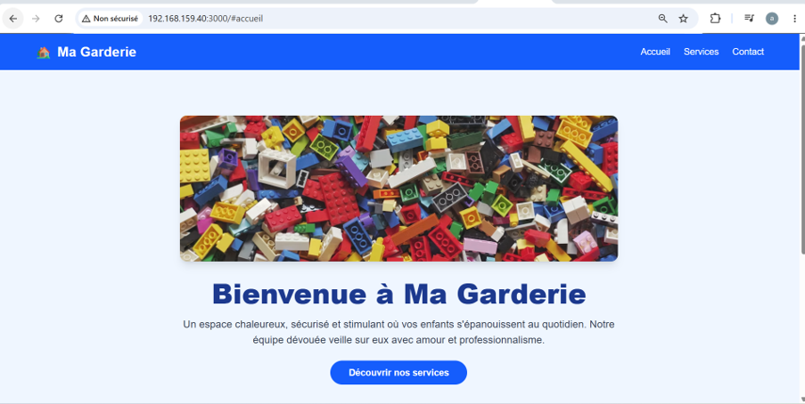

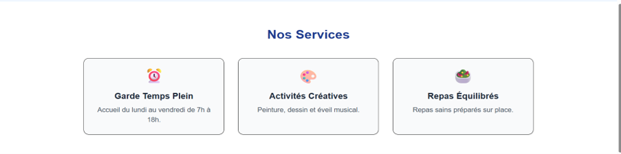

### 3.4. Développement et vérification de l'API REST

Le backend utilise Express pour exposer les routes de l'API REST. Cette API assure la communication entre le frontend et le serveur.

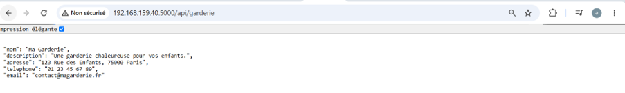

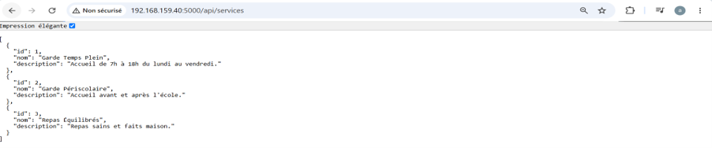

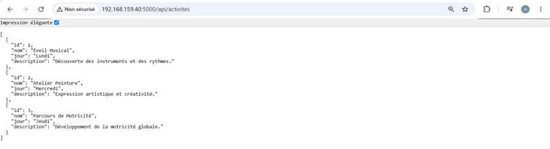

### 3.5. Tests automatisés avec Jest

Jest est utilisé pour exécuter les tests automatisés du projet. Cette étape permet de vérifier le comportement du code et de détecter certaines erreurs avant la construction des images Docker.

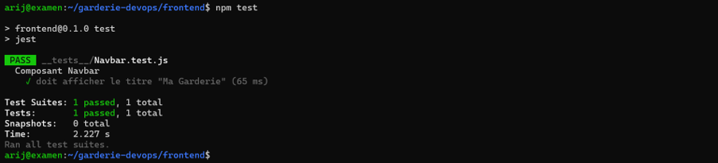

### 3.6. Construction des images Docker

Les images Docker du frontend et du backend sont construites afin de garantir un environnement d'exécution reproductible et de faciliter le déploiement.

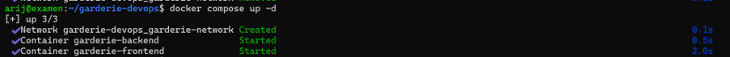

### 3.7. Déploiement local avec Docker Compose

Docker Compose permet de lancer les différents services de l'application à partir du fichier `docker-compose.yml`. Il simplifie la gestion des conteneurs et leur démarrage.

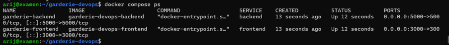

### 3.8. Configuration des identifiants Jenkins

Les identifiants Jenkins permettent au pipeline d'accéder aux ressources nécessaires, notamment pour publier les images sur Docker Hub. Les informations sensibles doivent être stockées dans le gestionnaire de credentials de Jenkins.

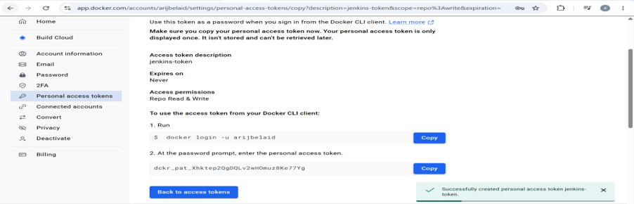

### 3.9. Pipeline Jenkins exécuté avec succès

Après la configuration des identifiants, le pipeline CI/CD est exécuté afin de vérifier le déroulement des différentes étapes d'automatisation : récupération du code source, installation des dépendances, tests, construction des images Docker et publication sur Docker Hub.

La capture suivante présente le résultat de l'exécution du pipeline Jenkins.

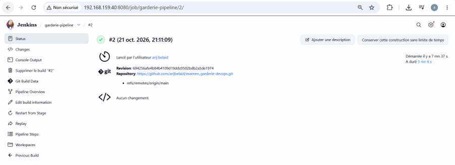

### 3.10. Publication des images sur Docker Hub

Après leur construction, les images Docker sont publiées sur Docker Hub. Elles peuvent ensuite être récupérées par l'environnement de déploiement.

- **Frontend :** [arijbelaid/garderie-frontend](https://hub.docker.com/r/arijbelaid/garderie-frontend)
- **Backend :** [arijbelaid/garderie-backend](https://hub.docker.com/r/arijbelaid/garderie-backend)

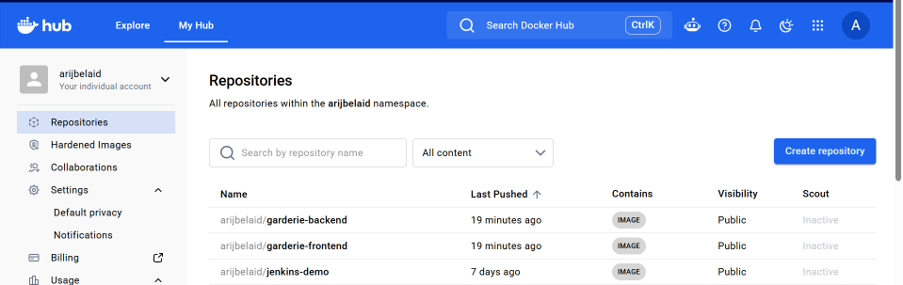

### 3.11. Configuration d'Ansible

Ansible est utilisé pour automatiser la configuration de l'environnement. Cette approche réduit les interventions manuelles et rend le processus de provisioning plus reproductible.

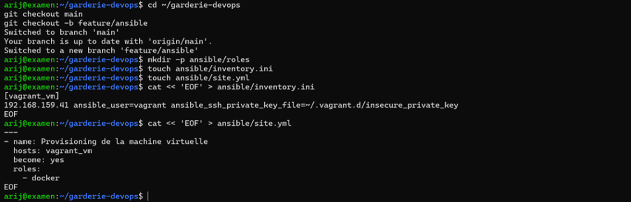

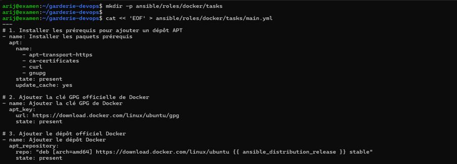

### 3.12. Exécution du playbook Ansible

Le playbook `site.yml` décrit les tâches d'automatisation. Il peut être exécuté à l'aide de la commande suivante :

```bash
cd ansible
sudo ansible-playbook -i inventory.ini site.yml
```


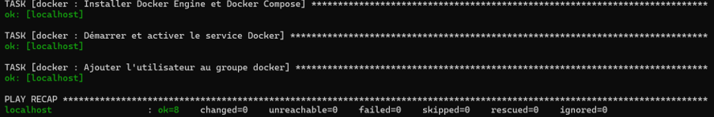

### 3.13. Déploiement final avec Docker Hub

Le déploiement final utilise les images publiées sur Docker Hub. Docker Compose permet de démarrer les services de l'application dans l'environnement cible.

Pour arrêter les conteneurs existants :

```bash
docker compose down
```

Pour démarrer l'application :

```bash
docker compose up -d
```

Pour vérifier l'état des services :

```bash
docker compose ps
```

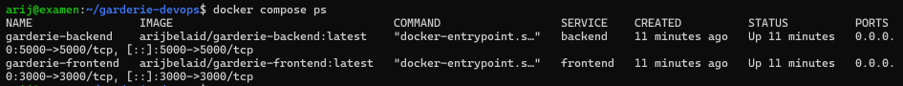

### 3.14. Vérification de l'application finale

La dernière étape consiste à accéder à l'application depuis un navigateur et à vérifier que l'interface est disponible.

**Adresse d'accès :** [http://192.168.159.40:3000](http://192.168.159.40:3000)

> Cette adresse fonctionne si la machine est accessible sur le réseau et si le frontend est exposé sur le port 3000.

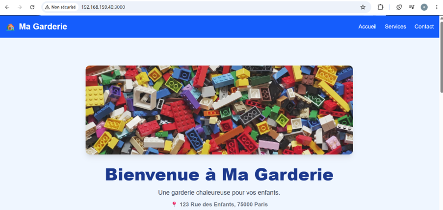

## 🚀 4. Instructions de lancement

### Prérequis

- Docker et Docker Compose
- Git
- Jenkins, pour l'exécution du pipeline CI/CD
- Ansible, pour l'automatisation de l'infrastructure
- Vagrant et un hyperviseur compatible, si la virtualisation est disponible

### Récupération du projet

```bash
git clone https://github.com/arijbelaid/examen_garderie-devops.git
cd examen_garderie-devops
```

### Démarrage des services

```bash
docker compose up -d
```

### Vérification des conteneurs

```bash
docker compose ps
```

Pour consulter les logs des services :

```bash
docker compose logs -f
```

Accéder ensuite à l'adresse du frontend configurée dans l'environnement.

## 🔗 5. Ressources du projet

- **Dépôt GitHub :** [examen_garderie-devops](https://github.com/arijbelaid/examen_garderie-devops)
- **Image Docker Frontend :** [garderie-frontend](https://hub.docker.com/r/arijbelaid/garderie-frontend)
- **Image Docker Backend :** [garderie-backend](https://hub.docker.com/r/arijbelaid/garderie-backend)

## ✅ 6. Conclusion

Ce projet a permis de mettre en pratique les principaux concepts DevOps à travers le développement et le déploiement d'une application web conteneurisée.

Les principaux objectifs sont :

- Développer une application composée d'un frontend et d'un backend.
- Mettre en place une API REST.
- Automatiser les tests avec Jest.
- Construire les images Docker.
- Orchestrer les services avec Docker Compose.
- Automatiser la configuration de l'infrastructure avec Ansible.
- Mettre en place un pipeline CI/CD avec Jenkins.
- Publier les images sur Docker Hub.
- Documenter les différentes étapes avec des captures d'écran.

Cette réalisation illustre l'intérêt de l'automatisation, de la conteneurisation et de l'intégration continue pour améliorer la reproductibilité et la fiabilité du déploiement.

---

**Projet :** Ma Garderie — Master DevOps & Cloud

**Dépôt GitHub :** [examen_garderie-devops](https://github.com/arijbelaid/examen_garderie-devops)
